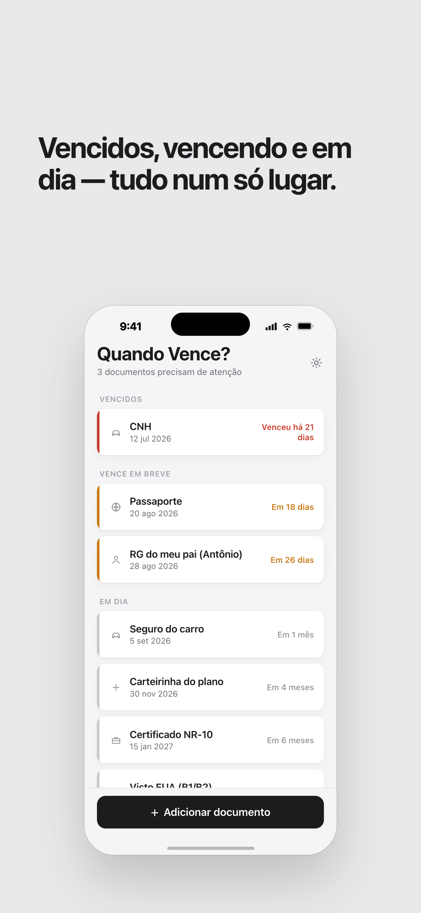
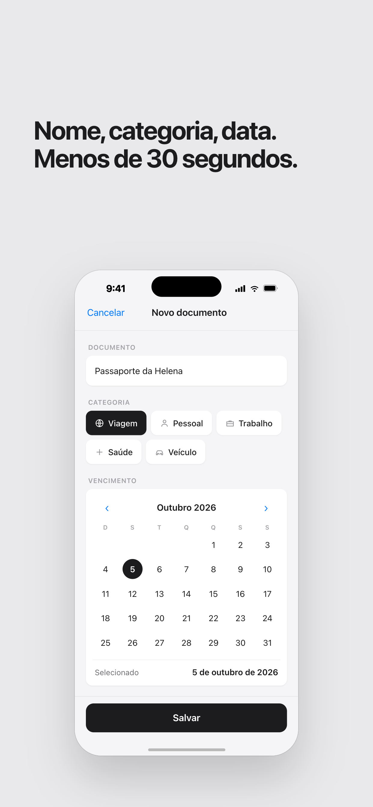
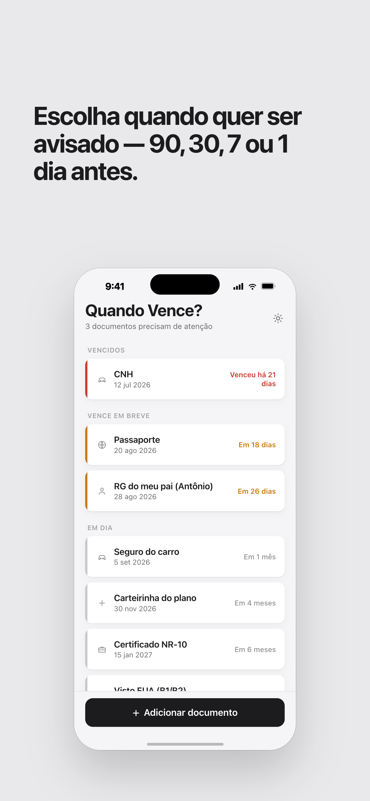
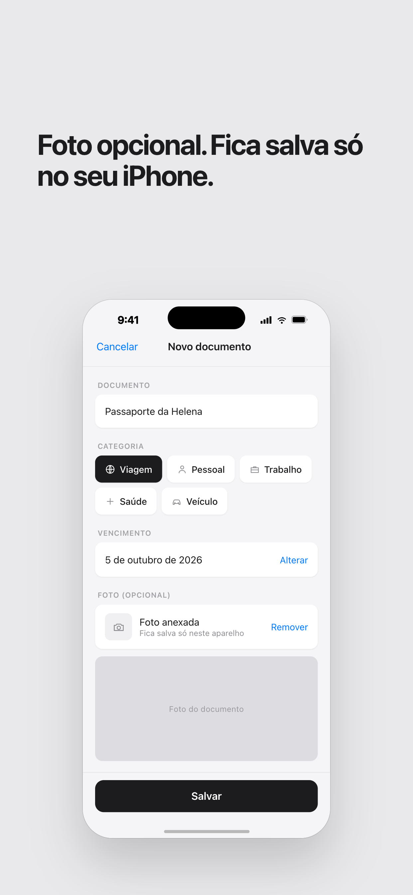
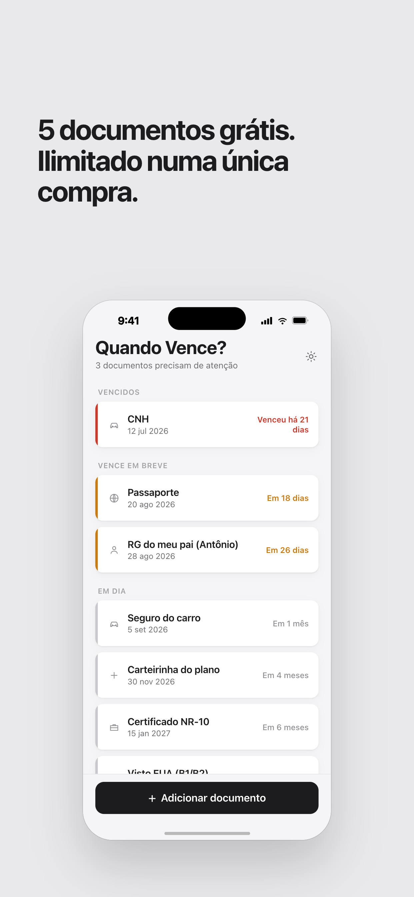

# Quando Vence?

App para iPhone que guarda a data de vencimento dos seus documentos pessoais (passaporte, CNH, RG, vistos, licenças, seguros) e avisa antes que eles vençam.

[Baixar na App Store](https://apps.apple.com/br/app/quando-vence/id6797344966)

<p>
  
  
  
  
  
</p>

## Principais funcionalidades

- Cadastro rápido: nome, categoria (viagem, pessoal, trabalho, saúde, veículo) e data; foto de referência opcional.
- Lista agrupada por urgência: **Vencidos**, **Vence em breve** (até 30 dias) e **Em dia**, com resumo no topo.
- Detalhe com a contagem de dias até (ou desde) o vencimento.
- Avisos locais configuráveis (90, 30, 7 e 1 dia antes) em um de quatro horários, mais um aviso sempre no dia do vencimento.
- Editar a data reagenda os avisos; excluir cancela os pendentes.
- 100% offline: sem conta, sem nuvem, sem rede. Nada sai do iPhone.
- Grátis até 5 documentos; compra única desbloqueia cadastro ilimitado.

## Stack técnica

- Swift + SwiftUI, iOS 26+, somente iPhone
- SwiftData (persistência local, tabela única)
- UserNotifications (notificações locais agendadas, sem push)
- StoreKit 2 (compra única não-consumível)
- XcodeGen (`project.yml` gera o projeto Xcode)
- XCTest (testes unitários)

## Como foi construído

Desenvolvido com Claude (Anthropic) a partir de uma especificação SDD: [spec-quando-vence.md](spec-quando-vence.md). A spec define princípios, modelo de dados, regras de negócio, critérios de aceite e um protocolo de mudanças incrementais; o comportamento como implementado está em [QuandoVence/DOCUMENTACAO-TECNICA.md](QuandoVence/DOCUMENTACAO-TECNICA.md).

- Testes unitários em [`QuandoVence/QuandoVenceTests/`](QuandoVence/QuandoVenceTests/) cobrem o cálculo de urgência, o agrupamento da lista e as regras de negócio.
- O layout partiu de um protótipo feito no Claude Design ([`quando-vence-handoff/`](quando-vence-handoff/) e [`design/`](design/)).
- Modelo de dados em [`modelo-quando-vence.dbml`](modelo-quando-vence.dbml).

## Status

Publicado na App Store (iOS).

## Licença

O código está disponível apenas para leitura e estudo. Veja [LICENSE](LICENSE).

## Contribuições

Issues são bem-vindas; pull requests não são aceitos. Veja [CONTRIBUTING.md](CONTRIBUTING.md).

## Como rodar

```bash
cd QuandoVence
xcodegen generate
open QuandoVence.xcodeproj
```

O scheme usa o arquivo `QuandoVence.storekit` para testar a compra localmente. Os testes rodam com `⌘U` no Xcode.

---

Feito pela [Dab Lab](https://www.dablab.com.br/) — agência de inovação no-code para startups e PMEs, com automações usando IA.
